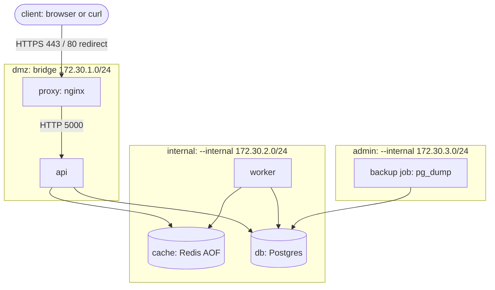

# Linkly: segmented multi-network Docker stack

Linkly is a URL shortener with click analytics. This repo containerizes it with plain `docker`
CLI commands (no Compose): 6 services on 3 segmented networks, non-root images, least-privilege
containers, persistent volumes, backups and a script that proves the network segmentation.
Application code is untouched; everything is done through Dockerfiles, env vars and `docker run` flags.

## Architecture



Volumes: `pgdata` (db), `redisdata` (cache), `reports` (worker). Backups go to `./backups` (bind mount).
Only the `proxy` publishes ports (`80:8080`, `443:8443`). Only the `api` is on both `dmz` and `internal`.

## Reachability matrix (latest `./scripts/netcheck.sh` run)

| From \ To | api :5000 | db :5432 | cache :6379 | Internet (1.1.1.1:443) |
| --- | --- | --- | --- | --- |
| proxy | Allowed | Blocked (no-DNS) | Blocked (no-DNS) | Allowed |
| api | — | Allowed | Allowed | Allowed |
| worker | Allowed | Allowed | Allowed | Blocked (timeout) |
| cache | Allowed | Allowed | — | Blocked (timeout) |
| db | Allowed | — | Allowed | Blocked (timeout) |
| backup job | Blocked (no-DNS) | Allowed | Blocked (no-DNS) | Blocked (timeout) |

_Output of `./scripts/netcheck.sh` (exit code 0, every cell matches the expected value), 2026-11-10 16:37 UTC. Full run: `docs/evidence/08-netcheck.txt`._

### Why is the api reachable from `internal`?
The api must talk to `db` and `cache`, so it has to be on `internal`. A Docker bridge network is a
flat layer-2 segment: every container on it can open connections to every other one on any port.
So worker, cache and db can also reach `api:5000`. This is acceptable here because the api exposes
no admin functionality, db and cache hold no outbound credentials for the api, and the network has
no internet access. To remove it, split `internal` into per-pair networks (`api-db`, `api-cache`,
`worker-db`, `worker-cache`) so that each service only shares a network with what it needs, or enforce
rules with iptables in the `DOCKER-USER` chain.

## Setup

Needs Docker Engine, git, curl, openssl.

```bash
git clone https://github.com/rrohansaini/linkly-capstone.git && cd linkly-capstone
export DOCKERHUB_USER=rrohansaini
./scripts/up.sh            # generates secrets + TLS cert, builds, starts in order, waits for health
curl -sk -X POST https://localhost/links -H 'Content-Type: application/json' -d '{"url":"https://example.com"}'
./scripts/netcheck.sh      # proves the matrix, exits 0 if it matches
./scripts/backup.sh        # timestamped .sql.gz in ./backups
./scripts/push.sh          # push images tagged with the git SHA
./scripts/scan.sh          # trivy: 0 fixable CRITICAL
./scripts/collect-evidence.sh --durability   # regenerates docs/evidence/*
./scripts/down.sh          # removes containers and networks, keeps volumes
```

The database password is generated into `secrets/db_password` (gitignored) and mounted read-only at
`/run/secrets/db_password`; services get only `DB_PASSWORD_FILE` / `POSTGRES_PASSWORD_FILE`.

## Docker Hub images
- https://hub.docker.com/r/rrohansaini/linkly-api
- https://hub.docker.com/r/rrohansaini/linkly-worker

Tag = short git SHA of the commit they were built from.

## Images
- **api** (`api/Dockerfile`): multi-stage build on `python:3.12-slim-bookworm`. Dependencies are installed
  in the build stage (requirements first, so the layer is cached), unused files are removed, and the result is
  flattened into one layer so the final image stays under 200 MB. Runs as UID 10001, Gunicorn binds
  `0.0.0.0:5000`, `HEALTHCHECK` uses the provided `healthcheck.py`.
- **worker** (`worker/Dockerfile`): `python:3.12-slim-bookworm`, UID 10001, `/reports` pre-created and owned by
  10001 so a new named volume is writable, `HEALTHCHECK` uses the provided `healthcheck.py`.
- Both are tagged with the short git SHA; see `docs/evidence/image-digests.txt`.

## Security summary
Every container: `--cap-drop ALL` (db adds only CHOWN, DAC_OVERRIDE, FOWNER, SETUID, SETGID for its
init), `--security-opt no-new-privileges`, `--read-only` with `--tmpfs` where needed, `--memory` and
`--cpus`. api/worker run as UID 10001. No `--privileged`, no host networking, no Docker socket.

## Incidents and evidence
- `docs/incidents/`: 6 write-ups (symptom, commands with output, root cause, fix)
- `docs/evidence/`: real output of every success-metric check
